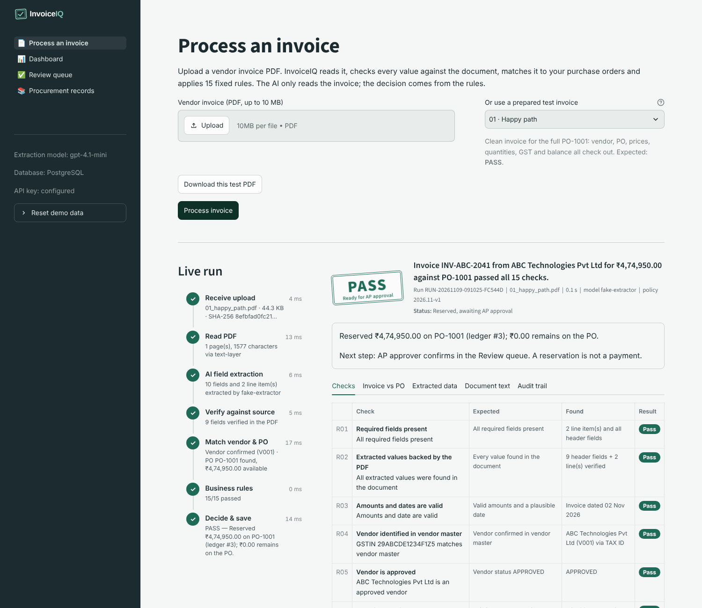
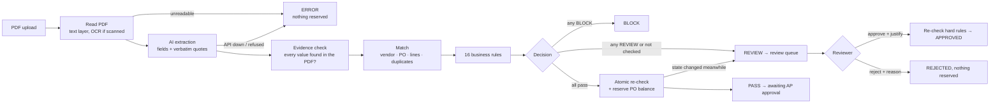

# InvoiceIQ — from invoice PDF to a decision you can defend

Zamp AI Solutions Analyst case study · **PS-1: Invoice processing**

A mid-size company's AP team opens every vendor invoice, finds the purchase order in a
spreadsheet, checks the numbers and decides what to do. InvoiceIQ automates that work.
Upload a PDF and it reads the invoice, proves every extracted value against the document,
matches it to vendors, POs and earlier invoices, and applies 16 fixed business rules. The
result is **PASS**, **REVIEW**, **BLOCK** or **ERROR**, with every step visible and saved.

**Demo video (5 min):** https://drive.google.com/file/d/1NMYCZZJhV1-GSiKtnmjYxoll0TnkbDaN/view?usp=sharing

**Try it in 5 minutes:** follow [Run it locally](#run-it-locally-windows--macos--linux) (you need
a free Groq key), pick **01 · Happy path** under "Or try a prepared test invoice" and select
**Process invoice** (PASS). Then process **07 · Duplicate re-sent** (BLOCK) and **06 · Missing PO**
(REVIEW), and open the **Review queue** and **Dashboard**. All 15 test PDFs, with the expected
result for each, are in `data/sample_invoices/`. No key? `pytest` runs all 213 tests without one.



---

## The one design decision that matters

> **AI reads. Code decides.**

| Step | Who does it | Why |
|---|---|---|
| Read a messy invoice into fields | **AI** (Groq `gpt-oss-120b`, strict JSON-schema output) | Every vendor's layout is different |
| Prove each value exists in the PDF | **Python** (`evidence_validator.py`) | The AI could misread or invent a value |
| Look up vendor, PO, earlier invoices | **Database** (`matcher.py`) | Facts come from records, not from the model |
| Apply the business rules | **Python** (`rules.py`, 16 rules) | Same input + same state → same answer, always |
| Write the explanation | **Python** (`reporting.py`) | Built from rule results, so it can't overstate |
| Approve payment | **A person** (Review queue) | PASS means "ready for AP approval", not "paid" |

If anything is uncertain the system **fails closed**. A value it can't find in the PDF, a
rule it couldn't evaluate, an AI timeout: none of these can ever become a PASS.

## Process map



Each stage is written to the database the moment it finishes. The live view in the UI
is driven by those real events, not by an animation.

## The four edge cases I chose

The brief asks for 2–4 edge cases that show how well you understand the problem. These
four are the AP situations the problem statement itself describes:

| # | Edge case | What happens | Why it matters |
|---|---|---|---|
| 1 | **Split billing across one PO** (`02`, `03`) | A 12-month service PO already has 8 months invoiced. Part 1 (2 months) passes and reserves. The next invoice claims 3 months, but only 2 remain → **REVIEW**, showing the exact over-run (₹59,000, 1 month). | "A vendor might split a single PO into multiple invoices." Checking the invoice against the PO total alone would miss this; the system tracks cumulative value **and** quantity. |
| 2 | **Amounts close but not exact** (`04`, `05`) | Toner at ₹3,250 vs ₹3,200 approved (+1.56%) is inside the 2% tolerance → **PASS with a note**. Chairs at +10% → **REVIEW**. A reviewer can accept the variance with a written justification. | "Amounts might be close but not exact." Exact matching would flood AP with false alarms; no tolerance at all would let overcharging through. |
| 3 | **Missing PO reference** (`06`) | No PO is printed. The system **never invents one**. It ranks the vendor's open POs on line items, prices and balance, suggests PO-1004 (fit 100/100), and a reviewer confirms it. | "PO references might be explicit or implied." The AI must not guess, but the human still gets real help. |
| 4 | **Duplicate re-sent in a new format** (`07`) | The happy-path invoice re-sent as `INV/ABC/2041` in a different template: different file bytes, same invoice → **BLOCK**. Matching is on vendor + invoice number with punctuation and case removed, with the file hash only as a supporting signal. | Duplicate payment is the most expensive AP mistake, and a vendor re-sending the PDF is the common way it happens. |

Further scenarios are also handled and tested: an unapproved vendor (BLOCK), a vendor
billing another vendor's PO (BLOCK), totals that don't add up (REVIEW), an invoice that tells
the AI to approve it (REVIEW, with the instruction ignored and flagged), a scanned paper
invoice read by OCR (PASS), a missing invoice number (REVIEW), a PO that doesn't exist
(REVIEW with candidates), a corrupted file (ERROR) and an AI outage (ERROR).

## The 16 rules

| Rule | Check | If it fails |
|---|---|---|
| R01 | Invoice number, date, vendor, total and line items present | Review |
| R02 | Every extracted value found in the PDF text; nothing ambiguous | Review |
| R03 | Amounts parse exactly; date not in the future or older than a year | Review |
| R04 | Vendor confirmed by GSTIN or exact approved name/alias (fuzzy = suggestion only) | Review |
| R05 | Vendor is approved | **Block** |
| R06 | PO exists and is open (missing → ranked candidates) | Review |
| R07 | PO belongs to this vendor | **Block** |
| R08 | Not already reserved / approved / paid / waiting in review | **Block** |
| R09 | Currency is INR and matches the PO | Review |
| R10 | qty × price = line total; lines = subtotal; subtotal + tax + shipping − discount = total | Review |
| R11 | Each line matches a PO item; price within tolerance; cumulative qty within PO qty | Review |
| R12 | Tax = line amounts × the PO's GST rates (CGST+SGST or IGST) | Review |
| R13 | No shipping or discounts that aren't on the PO | Review |
| R14 | Total ≤ PO value − already reserved/approved/paid | Review |
| R15 | No text addressed to AI or automated systems | Review |
| R16 | Invoice is addressed to our company (bill-to GSTIN or name in `data/company.csv`) | **Block** (another company) / Review (not shown) |

Decision: any **BLOCK** → BLOCK; otherwise any REVIEW or *not checked* → REVIEW; otherwise
PASS. If any of the 16 rules failed to run, the decision engine raises an error rather than
passing.

## How "no random answers" is enforced

| Risk | Safeguard | Where |
|---|---|---|
| AI invents a value | Prompt forbids it; the value must appear inside a verbatim quote that must exist in the PDF | `extractor.py`, `evidence_validator.py` |
| AI misreads a number | Numbers are compared as parsed values, so `1,000.00` never matches inside `11,000.00`; arithmetic is cross-checked | `evidence_validator.py`, R10 |
| AI invents a PO | PO numbers are only looked up, never created; a missing PO yields suggestions, not an assignment | `matcher.py`, R06 |
| AI skips a value that is clearly printed | Code recovers only unambiguous, labelled values (one currency marker; one value after "Invoice No / Bill Reference") and records the source line; anything ambiguous stays REVIEW | `evidence_validator.py` |
| Inconsistent decisions | Pure functions over verified data; a repeat-run test proves the same result each time | `rules.py`, `test_rules.py` |
| Invoice tries to manipulate the AI | Text is treated as data; injection is detected by the model **and** by a regex backstop → REVIEW | R15 |
| Float rounding | Money is integer paise in the database and `Decimal` in Python | `money.py` |
| Two uploads race for the same balance | Re-check + reserve in one transaction (`BEGIN IMMEDIATE` on SQLite, `SELECT … FOR UPDATE` on Postgres) plus a partial unique index on the active invoice identity | `database.reserve_invoice` |
| State changed between check and commit | The commit-time re-check downgrades a stale PASS to BLOCK/REVIEW | `pipeline.finalize` |
| AI or database outage | ERROR, never PASS; nothing reserved; the run is still logged | `pipeline._fail` |
| Failure while saving the decision | Reservation, decision and audit records are committed in one transaction: all or nothing | `pipeline.finalize`, `database.reserve_in_transaction` |
| Failure *after* the decision is saved (UI, logging) | Cannot change the committed decision; ERROR is only recorded before anything is committed | `pipeline.process_invoice`, `pipeline._fail` |
| Same PDF re-submitted under a new number | Identical-file check (SHA-256) blocks re-processing and re-approval; same vendor + amount + date is flagged | `rules.check_duplicate`, `database.find_active_by_file_hash` |
| Line assembled from unrelated numbers | Quantity, price, total and item must be printed together on one row (3-line window) | `evidence_validator.find_item_row` |
| Invoice addressed to another company | R16 blocks it | `rules.check_billed_to_us` |
| AI invents an item description | A description must be printed on the invoice to be used for matching (on OCR pages the item code must be) | `evidence_validator.description_in_document` |
| Reviewer overrides a hard control | Approval re-runs the hard limits inside the same transaction; non-overridable failures are refused with reasons | `review.approval_blockers` |
| Anyone with the link approves or resets | Approve / reject / release / reset need `REVIEWER_PASSCODE` on the hosted app | `app.py` |
| Silent policy drift | Model name and policy version stored on every run | `processing_runs` |

Note that the **same PDF can get a different decision later**, and that's correct. The first
upload passes and reserves; the second is a duplicate. To test consistency, hold the data and
the database state fixed.

## Architecture

```
app.py                     Streamlit UI: Process · Dashboard · Review queue · Records
src/
  config.py                Business policy + settings (single source of thresholds)
  money.py                 Exact amount parsing, paise, Indian formatting
  pdf_reader.py            PyMuPDF text layer → Tesseract OCR fallback
  schemas.py               Strict extraction schema (values as printed + quotes)
  extractor.py             Groq / Gemini / OpenAI schema-constrained extraction; retries; error mapping
  evidence_validator.py    Proves each value against the PDF text; parses dates/amounts
  database.py              Schema, seed, queries, atomic reservation (SQLite + Postgres)
  matcher.py               Vendor / PO / line matching, candidate POs, duplicates
  rules.py                 The 16 rules
  decision_engine.py       Rules → PASS/REVIEW/BLOCK (fails if any rule missing)
  reporting.py             Explanation assembled from rule results
  pipeline.py              Orchestrator with per-stage logging + live callbacks
  review.py                Human approve / reject / release; hard limits re-checked in one transaction
  ui.py                    Timeline, decision stamp, evidence and comparison views
scripts/                   init_db · reset_demo · run_samples · generate_sample_invoices
data/                      Seed CSVs + 15 sample invoices + manifest (expected results)
tests/                     213 tests: unit, integration, concurrency, end-to-end, audit regressions
```

**Database tables:** `vendors`, `vendor_aliases`, `purchase_orders`, `po_line_items`,
`invoice_ledger` (with a partial unique index on active vendor + invoice number),
`ledger_lines` (quantity consumed per PO line), `processing_runs`, `run_stages`,
`rule_checks` and `review_actions`.

## Tech stack

Python 3.11+ · Streamlit · PyMuPDF with built-in Tesseract OCR · Groq (free tier), with Gemini or OpenAI as alternatives
(schema-constrained output) · Pydantic · SQLAlchemy (SQLite locally, PostgreSQL hosted) · pytest · ReportLab
(test data).

## AI provider

Three providers are supported, with identical prompt, schema and verification:

- **Groq (default, free tier).** Key from console.groq.com/keys → `GROQ_API_KEY`. Default
  model `openai/gpt-oss-120b`, which supports strict JSON-schema output. The free tier is
  limited by tokens per minute and per day, so `run_samples.py` paces itself; if the daily
  allowance runs out, `GROQ_MODEL=openai/gpt-oss-20b` has its own allowance.
- **Google Gemini (free tier).** Key from aistudio.google.com/apikey → `GEMINI_API_KEY`.
  Default model `gemini-3.8-flash` (change with `GEMINI_MODEL`).
- **OpenAI.** Set `OPENAI_API_KEY` (and optionally `OPENAI_MODEL`).

Set `LLM_PROVIDER` to choose; without it, the first provider with a real key is used (Groq first).
Template placeholder keys are ignored. The provider
and exact model version are stored on every run.

## Run it locally (Windows / macOS / Linux)

```powershell
git clone https://github.com/<you>/invoiceiq.git
cd invoiceiq
py -3.12 -m venv .venv
.venv\Scripts\Activate.ps1            # macOS/Linux: source .venv/bin/activate
pip install -r requirements.txt
copy .env.example .env                 # then put your GROQ_API_KEY (free) in .env
streamlit run app.py
```

The database creates and seeds itself on first start. Choose **01 · Happy path** in "Or use
a prepared test invoice" and select **Process invoice**.

**OCR works out of the box.** PyMuPDF has the Tesseract engine built in and only needs the
English language file, which ships in `tessdata/eng.traineddata` (Apache-2.0, from
tesseract-ocr/tessdata_fast). Nothing to install. To use your own language data instead,
set `TESSDATA_PREFIX`.

## Troubleshooting (Windows)

**`ImportError: DLL load failed ... An Application Control policy has blocked this file`**
Windows Smart App Control (or a managed-device policy) blocks a compiled `.pyd` file. For
SQLAlchemy, reinstall it without compiled extensions. It ships a pure-Python version and the
full test suite passes on it:

```powershell
$env:DISABLE_SQLALCHEMY_CEXT = "1"
python -m pip install --force-reinstall --no-deps --no-binary sqlalchemy "sqlalchemy>=2.0.30,<3"
```

If pandas or pyarrow is blocked (usually right after an upgrade), go back to an older,
widely used version, which Smart App Control trusts:

```powershell
python -m pip install "pandas==2.3.3" "pyarrow==18.1.0"
```

The hosted deployment (Linux) is unaffected either way.

**`database is locked` with the project inside OneDrive.** Move the folder outside OneDrive
(e.g. `C:\Projects\invoiceiq`); file syncing can interfere with SQLite.

## Tests

`tests/test_audit_findings.py` reproduces every loophole found in an external review (negative and
unverified approvals, invented descriptions, cross-vendor PO reassignment, failures after reservation,
suspended vendors / closed POs after PASS, conflicting GSTIN and name, partial item codes, zero-priced
PO items, over-precise quantities) and asserts each one is closed.


```bash
pytest                                    # 213 tests, ~12 s, no API key needed
TEST_DATABASE_URL=postgresql://... pytest # the same suite against PostgreSQL
python scripts/run_samples.py             # all 15 samples through the REAL AI extractor
python scripts/run_samples.py --repeat 3  # consistency check across repeated runs
```

Automated tests replace the AI with a stand-in that returns each invoice's known ground
truth, building quotes from the real PDF text. That isolates business logic from model
variability. They check database state, not just the displayed answer: exactly one
reservation, correct PO balances, saved audit rows, and safe re-uploads under 6-way
concurrency. The suite passes on both SQLite and PostgreSQL 16.

## Optional: deploy (Streamlit Community Cloud + Supabase)

1. **Database.** Create a free Supabase project. Under Connect, copy the **Session pooler**
   URI (IPv4-compatible) and substitute your password.
2. **GitHub.** Push this repo. `.env` and `secrets.toml` are git-ignored.
3. **Streamlit.** Go to share.streamlit.io → Create app, pick the repo, set main file
   `app.py`, and under Advanced settings choose Python 3.12.
4. **Secrets.** Paste the lines from `.streamlit/secrets.toml.example` with real values, including a
   `REVIEWER_PASSCODE` so only you can approve, reject or reset on the public app.
5. Deploy. `requirements.txt` installs everything (OCR data is bundled). Tables and seed data
   are created on first start.
6. **Persistence test.** Process `01`, refresh, open the app in another browser, confirm the
   run is still on the Dashboard, re-upload `01` → BLOCK, and confirm Records shows one
   reservation.

Before an interview, open the app a few minutes early. Free Streamlit apps sleep when idle,
and free Supabase projects pause after a week without activity. Then use **Reset demo
data** under **Settings** (top right of every page).

## Assumptions (policy `2026.11-v1`)

- **Two-way match** (invoice ↔ PO). No goods-receipt (three-way) matching in the MVP.
- **PO values are gross** (including GST), so balances and invoice totals are on the same basis.
- **INR only**, Indian GST: CGST+SGST for intra-state supply, IGST for inter-state supply.
- **Price tolerance:** up to **2% above** the PO price **and** at most ₹500 per unit. Billing
  below the PO price is fine.
- **Arithmetic / tax tolerance:** ₹1, for per-line rounding.
- **Committed balance** = RESERVED + APPROVED + PAID. Blocked, rejected and failed runs never
  consume balance.
- **Duplicate identity** = confirmed vendor + invoice number, uppercase, alphanumerics only.
- **Dates** like `05/11/2026` are read as DD/MM/YYYY (Indian convention).
- **Seed data** includes a real-world GST layout: CloudZen Software Labs (V006) with PO-1007
  (5 lines, mixed 18%/28% IGST, PO value ₹47,924.68). The public GSTZen demo invoice is billed to
  *Cipla Ltd*, so it is correctly **blocked** by R16; the same invoice billed to us passes, with its
  ₹0.32 round-off accepted by the ₹1 rounding tolerance.
- **PO balance rounding:** an invoice may exceed the remaining PO balance by at most ₹1 (round-off).
- Shipping and discounts not on the PO go to a human; the accounting treatment isn't guessed.
- **A PASS is a reservation, not a payment.** An AP approver confirms it in the Review queue.
- **Human review is a control, not a way around controls.** With a written justification a reviewer may
  accept: a price variance, a missing PO reference (choosing one of the vendor's open POs whose items
  match), an old invoice date, a missing invoice number, a tax/shipping difference. A reviewer can
  **never** approve: a zero/negative or unverified total, arithmetic that doesn't reconcile, a missing or
  non-INR currency, an unconfirmed or unapproved vendor (fix the vendor master instead), a different PO
  than the one printed, a PO whose items don't match, more quantity or money than the PO has left, or a
  duplicate. The review screen lists any such blocker before approval is attempted, and the accepted
  exceptions are recorded with the justification in the audit trail.

## Limitations (deliberate, for a one-week MVP)

- No three-way match against goods receipts.
- No credit notes, negative lines or multi-currency (all → REVIEW).
- No dedicated tax-inclusive-pricing detector. Such invoices still go to REVIEW in practice: their unit
  prices sit ~18% above the PO price (R11) and no separate GST is shown (R12).
- GST *type* (CGST+SGST vs IGST) is not validated; R12 checks the total GST against PO rates.
- No bank-account verification or invoice versioning.
- Each item line's quantity, unit price, line total and name/code must appear together within 3
  consecutive lines of the invoice. This is a lightweight row check, not full table-structure parsing;
  arithmetic, tax and PO-price checks are the further cross-check.
- A known GSTIN is only accepted when the printed supplier name is consistent with it; this is
  invoice-to-PO validation, not full fraud detection.
- Multi-page invoices up to 10 pages; very long line-item tables haven't been stress-tested.
- Line matching is by item code or exact description. Near-matches are shown as suggestions,
  not auto-matched.
- No user accounts or role separation: one `REVIEWER_PASSCODE`='1234' protects reviewer actions, and
  "Reviewing as" is a free-text name.
- Evidence checks prove a value *exists* in the document, not that it was taken from the right
  label. Arithmetic, tax and PO checks are the second line of defence against that.

## What I'd build next

1. An email inbox connector, so invoices arrive automatically (the real input channel in the brief).
2. Goods receipt data for three-way matching.
3. Per-vendor tolerance and layout memory (known-good extraction examples per vendor).
4. Roles and approval limits (e.g. above ₹5 L needs a finance manager).
5. A daily exceptions digest to the AP lead.

## Demo
REVIEWER PASSCODE = '1234'
USE THIS PASSCODE TO RESET ALL THE DEMO DATA THAT WAS PREVIOUSLY UPLOADED FROM SETTINGS ON THE HOMEPAGE

See [`docs/DEMO_SCRIPT.md`](docs/DEMO_SCRIPT.md) for the run order and talking points.
